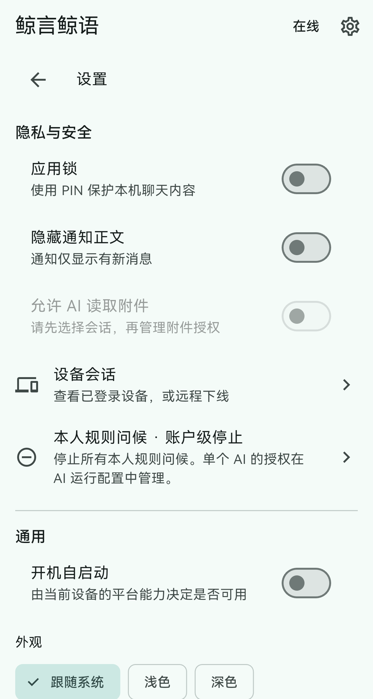
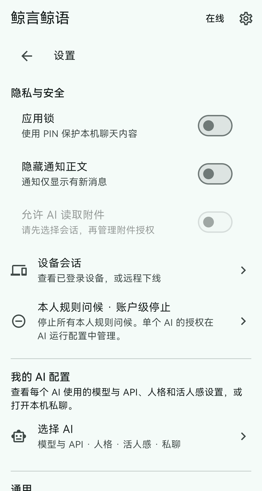

# Android native acceptance — private AI and settings

Only synthetic fixture data is used. These are real captures and observations from an authorized physical handset (Android 12/API 31, arm64), at 1176 × 2400 px / density 480, portrait, light theme, text scale 1.0. Both main comparison images use the initial authenticated **Settings** viewport (no scroll, same account after upgrade). The exact same crop removes system status and navigation areas (y=100 to y=2299; resulting 1176 × 2200 px); the app content is not redrawn or rearranged. The raster was checked using on-host OCR and matched against live Android accessibility bounds; no sign-in or credential-input screen is included.

| Before — `87de5f3` | After — `a9e08fc` |
| --- | --- |
|  |  |

Additional handset captures: [model/persona menu](persona-menu.png), [saved persona](persona-saved.png), [saved social level](behavior-saved.png), [offline restart](offline-restart.png), [reconnected sync](reconnected-sync.png), and [logical removal](removal-result.png).

## Test isolation

The Before app is based on main `87de5f3`. The primary After image uses the fixed Android Settings editor (`a9e08fc`, Settings source blob `e72f75a3`); the earlier private-chat, persona and removal images use `8855d60`. Both builds were installed under the same disposable QA package ID, distinct from and alongside the existing app. The candidate QA build used a test-only entry point to trust the disposable loopback provider's certificate authority; it never bypassed certificate/hostname validation. This test-only package ID, entry point, and CA are not included in the product change. The owner, AI records, messages, model endpoint, and key were synthetic. The synthetic host ran from the candidate sources with the normal authentication algorithm. No personal app data was read, reset, upgraded or published.

## Observed on the handset

- Upgraded the QA package from Before to After without clearing its application data. The signed-in synthetic session persisted and Settings showed the new Android AI entry.
- Refreshed two owned AI accounts. The selected AI settings showed its saved model/API, active persona version and content. Edited only that AI's P1 value; the app showed revision 2 and an authenticated host read confirmed the value.
- An initial device run found that a routine refresh reset the social-level editor while it was open. After the route-lifetime fix, `L3` stayed visible through a refresh, a draft `L2` stayed selected through another, and saving returned confirmed `L2` on the handset. A separate host read confirmed `L2`, the retained persona and the exact exchange.
- Opened the dedicated private chat and checked the current model and persona in the chat UI. The persona menu showed the last-read host behavior summary; it does not imply host proactive behavior runs offline.
- Explicitly opted in to synchronization. Stopped the isolated host process and removed only its USB loopback mapping, leaving the independent HTTPS fixture reachable. A cold launch restored the roster, selected persona, model and saved key state. The phone sent a single synthetic prompt directly to the TLS fixture; the fixture verified the expected model, persona and user message and checked the key was not in the JSON body. The reply appeared as local-only/pending.
- Force-stopped/reopened the QA app again with the host still stopped. The prior turn, selected settings and pending status survived. The QA vault files contained no literal test conversation prefix. Restarted the same host and restored its mapping; the open chat showed the turn as synced. Manual sync again and a host API read using a separate fixture device found just one exact exchange, with no model key in the returned record.
- Cancelled removal of the unused second fixture AI; it remained listed. Confirmed removal; only that AI disappeared. A fresh host read still returned the retained AI's persona and one original exchange. This is logical removal (stop and hide), not history erasure.

The direct reply was from a deterministic OpenAI-compatible HTTPS fixture, not a live commercial model. Real offline editing of host settings and no-network on-device inference are out of scope. Host changes are needed for sync and AI removal; Windows and other existing chats retain their prior paths.
