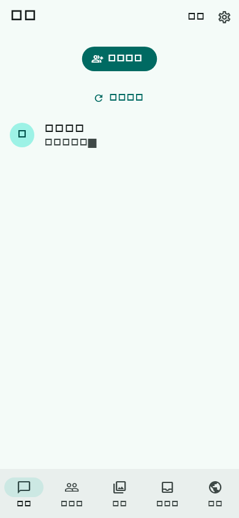
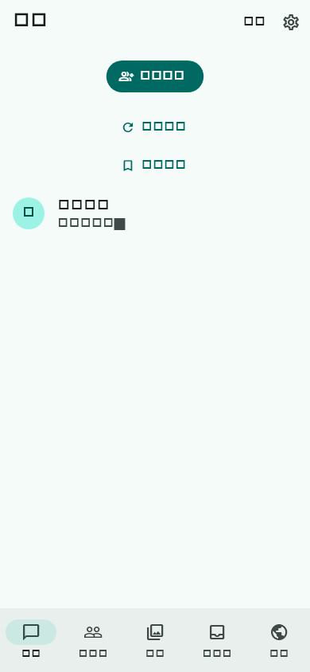
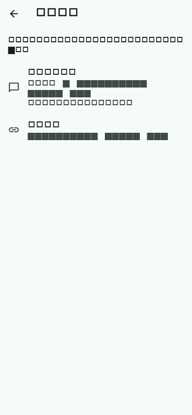

# Read-only favorites from the conversation list

#131 workstream A / FR-16 and AC-20 subset (REQ-035). The host's existing owner-scoped list remains the authority. The conversation list opens **我的收藏** without a request. **读取收藏** then issues one bounded `GET /api/v1/favorites`, with no query, owner override, redirect, or authentication replay. A fresh explicit read requires reopening the page.

## Matched production-widget evidence

Both images show the same unlocked, authenticated fixture account at the default Chat destination with one synthetic conversation (读书小组), before any tap or favorites request. The baseline is a detached checkout; its tracked source was unchanged. The final [capture driver](../favorites_read_capture_test.dart) rendered the real `WhaleChatApp`, `ClientRuntime` shell, and `ConversationList` at both revisions. The fixture supplies runtime state and a synthetic `HostConnection`; no live host, private data, installed app, or native device was used.

| State | Exact production revision | PNG SHA-256 |
| --- | --- | --- |
| [Before: no 我的收藏 entry](before-d916736.png) | `d916736a7a94fce09d0ee92476571509169ce99a` | `500F8CA0BE229CEB5A9DB5E9BF067ABA84A675BF9DA52552FEA1C109CF2AAE71` |
| [After: entry visible, no read yet](after-conversation-list.png) | `16830c731c53a3ac3bb0002534c6e2beb51e1be4` | `B04F94B7BB9B7F23CA27D2EC9AFD99D416D444F69924DB6D0C737A7022D5E5F5` |
| [After follow-on: explicit load, synthetic items](after-loaded-list.png) | `16830c731c53a3ac3bb0002534c6e2beb51e1be4` | `4FDA06448859AFAD1D5EE553F35F75C314AD9A830394C47F01C4C0C85015CCB3` |





The follow-on is **not** part of the matched pair. The driver taps the new entry, asserts zero reads, taps **读取收藏**, and asserts one GET, a visible message excerpt, and no displayed link destination.



- Flutter 3.50.0 / Dart 3.14.0, Windows widget harness, 390 × 844 logical and physical pixels, DPR 1, light theme. The same SimHei and Flutter Material icon fonts were injected for both runs.
- Driver SHA-256 `EEA3450D340CD8DC9D01C0104E22C37BC1A7436CB51C10DB212CCC226896E1D3`; dependency lock SHA-256 `C0BF09F7A5EF28F2AFAA8819BFE6A7ABDAC2A0F975D033C8B4E96D4D99099937` in both worktrees. Generated metadata was reused from a compatible cached resolution; no installation or manifest changes.
- PNGs are unretouched `RenderRepaintBoundary.toImage` output. This session verified the rendered widget states, dimensions and hashes; visual inspection is left to human review because the model does not accept image input.

### Reproduce

Copy the same driver into the client `evidence/` directory at the baseline revision. Start in `apps/client_flutter` with the same resolved dependencies. The Before command takes the baseline image; for After, run the same command from the code revision, set `CAPTURE_EXPECT_ENTRY=true`, change `CAPTURE_PATH`, and optionally provide the absolute `CAPTURE_FOLLOW_ON` output path.

```powershell
flutter test --no-pub evidence/favorites_read_capture_test.dart `
  '--dart-define=CAPTURE_PATH=C:\path\to\before.png' `
  '--dart-define=CAPTURE_CJK_FONT=C:\Windows\Fonts\simhei.ttf' `
  '--dart-define=CAPTURE_ICON_FONT=C:\path\to\flutter\bin\cache\artifacts\material_fonts\materialicons-regular.otf'
```

## Verification and limits

- **RED:** the 10 production-route widget tests failed on the missing entry, and the HTTP adapter tests could not load before the new module existed. The closed transport regression also failed with the shared client's `StateError` before that case was mapped to unavailable.
- **GREEN:** `flutter test --no-pub --concurrency=1 test/chat_favorites_route_test.dart test/favorites_api_test.dart test/voice_message_playback_test.dart`: 22 passed (10 favorites route tests, 8 favorites HTTP tests, 4 neighboring voice widget tests). Scoped `flutter analyze --no-pub` on the three changed production Dart files, both new tests, and the capture driver found no issues. The full client suite was not run for this slice.
- The adapter projects safe display fields only. Message previews take the validated JSON object's top-level string `text`; it is never echoed as a raw body. Plain text titles/excerpts are shortened and obvious JSON, paths, URLs and credential assignments are withheld; this is not a detector for arbitrary secrets written as free text. Link/file rows display kind and date only. Notes, tags, source IDs and extra body fields are not rendered, and rows have no navigation or attachment actions.
- The host omits message references that are no longer visible on the read. The client does not infer that an empty response means the owner has never saved a favorite. A malformed row or a response over the client’s 2 MiB cap yields no partial list. No pagination is invented for the existing unpaginated route.
- The per-route snapshot can become stale on the host. The client performs no polling or indexing. Lock, logout, account/session/connection changes, and route departure invalidate it; late results are discarded. This slice has no add/remove, editing, filtering, search changes, message jump, downloads, or native/live-host acceptance, and does not complete FR-16 or AC-20.
