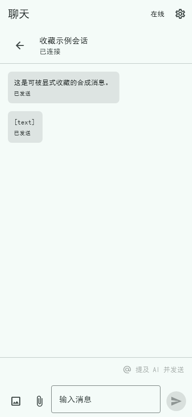
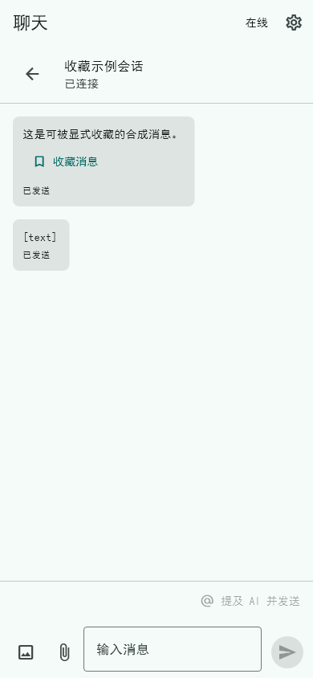
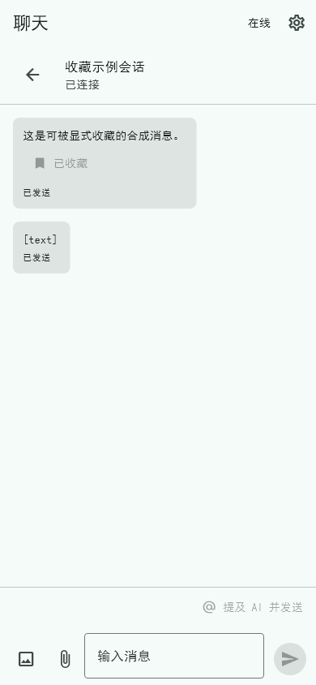

# Save a chat message to favorites

This is the chat-save step of #131 workstream A, FR-16 and AC-20 (REQ-035). A canonical, nonrecalled row offers **收藏消息**. The host determines visibility and ownership through the authenticated `POST /api/v1/favorites` route. The request contains `kind: message`, `conversationId`, and `messageId` only. The client shows **已收藏** after a verified host receipt. The existing **我的收藏** list remains the place to check an uncertain result.

## Matched production-widget evidence

Both screenshots show the same signed-in, unlocked, online client in **收藏示例会话**, with one synthetic canonical text message and one recall marker. The driver runs the production `WhaleChatApp` and `ClientRuntime` against an isolated loopback HTTP fixture for session restoration, conversations, sync, and the save receipt. The baseline was rendered from a detached checkout with clean tracked source. Both matched states were captured before the action and report zero favorite POSTs. [Capture driver](../message_favorite_capture_test.dart)

| State | Production revision | PNG SHA-256 |
| --- | --- | --- |
| [Before, chat row without the action](before-6c0c0c4.png) | `6c0c0c43283b2124fa14dd93a11a01d3012c684f` | `4A852610AC335402341A0B71FDA7927E30E11F742ED88777591A84A0B2CA3893` |
| [After, the same chat row offers 收藏消息](after-chat.png) | `d2c9db5cc309d876dd7badbb5051c9fcd4cf6b03` | `6E7B855F2A63615CB49DB184BE56A3B9429F71F0BEE9F2093AD060AB9097CC4C` |
| [Follow-on, 已收藏 after one tap and a fixture receipt](after-saved.png) | `d2c9db5cc309d876dd7badbb5051c9fcd4cf6b03` | `4CD6FE803C1D40297D4D4D20E9311B915B7B7D0FD6B751467B133508E24053C5` |





The follow-on captures the next state. The driver taps **收藏消息**, verifies exactly one POST with the three reference fields, and checks **已收藏** after the synthetic reply.



- Both runs used the Windows Flutter widget harness, 390 × 844 logical and physical pixels, DPR 1, light theme, and font scale 1. The driver loads SimHei as Roboto and Ahem and injects the Flutter Material icon font. PNGs came directly from `RenderRepaintBoundary.toImage`.
- Both runs used the same driver SHA-256 `92B57D0FA725055CCE6C0D5A1AD18980638475953EDDBCA1E068A07DB20BAB49` and cached dependency lock SHA-256 `C0BF09F7A5EF28F2AFAA8819BFE6A7ABDAC2A0F975D033C8B4E96D4D99099937`.
- Font SHA-256 values were `9B1959DB3B3ABEB7EFDAEC26EDF7DFE871A6039DE8D614AF7248575207BE629E` for SimHei and `D9865B671A09D683D13A863089D8825E0F61A37696CE5D7D448BC8023AA62453` for Material Icons.
- Both capture tests exited 0. Assertions, PNG dimensions, and hashes were checked programmatically. Visual review remains a human check because this session has no image input. The fixture exercises the production client over loopback. Live-host deployment and device acceptance remain outside this evidence.

### Reproduce

Copy the capture driver into `apps/client_flutter/evidence` on the detached Before worktree. From `apps/client_flutter` with cached dependencies, run the command below using the same fonts in both worktrees. For the production revision set `CAPTURE_EXPECT_ACTION=true`, change `CAPTURE_PATH` to the After image, and use `CAPTURE_FOLLOW_ON` for an optional saved-state PNG. [Capture driver](../message_favorite_capture_test.dart)

```powershell
flutter test --no-pub evidence/message_favorite_capture_test.dart `
  '--dart-define=CAPTURE_PATH=C:\path\to\before.png' `
  '--dart-define=CAPTURE_CJK_FONT=C:\Windows\Fonts\simhei.ttf' `
  '--dart-define=CAPTURE_ICON_FONT=C:\path\to\flutter\bin\cache\artifacts\material_fonts\materialicons-regular.otf'
```

## Verification and limits

- The first RED run found the missing adapter and runtime API. With those interfaces present, the widget suite reproduced nine failures because the chat action was absent. The final targeted run passed 91 tests. That includes 29 favorites API, runtime, and action tests and 62 adjacent favorites-list, group, mention, image, and voice tests. Scoped Flutter analysis of nine Dart files found no issues.
- Widget checks cover three viewport widths, the action disabled while awaiting the receipt, the disabled rejected and unknown states, stale lock and navigation, and same-frame departure. Runtime and loopback HTTP checks cover canonical eligibility, exact payload, duplicate suppression, refusal without auth replay, and discard of a late result.
- A submitted reference stays spent in memory during the current login, including a refusal or uncertain result. A POST already handed to transport may still commit after the view closes. The client discards its late result and performs no automatic retry. The host creates independent favorite IDs. Deduplication across logins, sessions on other devices, or restarts would require a separate contract.
- This slice covers one explicit message save. Removing favorites, editing metadata, and search sit outside the slice. FR-16 and AC-20 remain partially covered.

These commands ran from `apps/client_flutter` with the production code identified above.

```powershell
flutter analyze --no-pub lib/net/favorites_api.dart lib/app/shell_view_model.dart lib/app/runtime.dart lib/features/chat/chat_pane.dart lib/features/chat/message_favorite_action.dart test/favorites_api_test.dart test/runtime_message_favorite_test.dart test/message_favorite_action_test.dart evidence/message_favorite_capture_test.dart
flutter test --no-pub --concurrency=1 test/favorites_api_test.dart test/runtime_message_favorite_test.dart test/message_favorite_action_test.dart test/chat_favorites_route_test.dart test/group_chat_ui_test.dart test/mention_message_ui_test.dart test/message_image_preview_ui_test.dart test/runtime_image_preview_test.dart test/voice_message_api_test.dart test/voice_message_playback_test.dart test/runtime_voice_playback_test.dart
```
